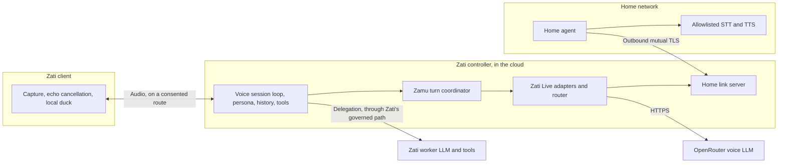
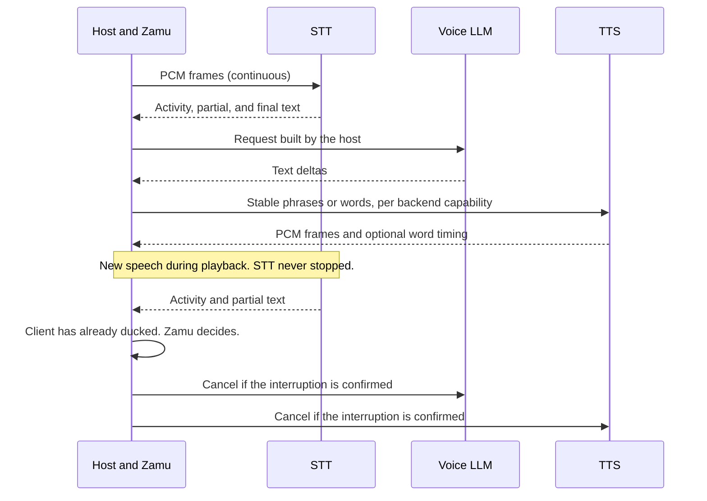
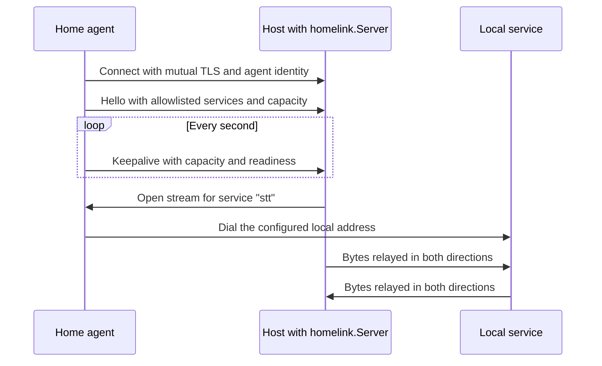

# RFC 001: Zati Live, a Go library for composed live voice

- **Status:** Draft. Not accepted. The owner confirmed D1 to D9 by 2026-11-03. D10 to D12 are assumptions until the owner confirms them.
- **Date:** 2026-11-03. First drafted 2026-11-02 as a multi-tenant gateway. [Section 3](#3-decisions) lists what that change replaced.
- **Implementation language:** Go
- **Evidence level:** Source and documentation review, plus speech-model and LLM speed tests ([section 10](#10-evidence)). The library hasn't been built, and no full conversation has run through it. All numeric targets are proposals.

## 1. Summary

Zati Live is a Go library that helps the Zati voice agent hold a live conversation using separate speech-to-text (STT), language model (LLM), and text-to-speech (TTS) backends. It isn't a service, and it has no tenants, accounts, or billing. A thin server may come later if a host needs one.

The library does one job: it gets speech in and out quickly, across backends that can fail, and it tells its host exactly what happened.

Four boundaries shape the design:

1. **Zati Live owns backends.** It provides streaming STT, TTS, and voice-LLM adapters, routing between them, and an optional outbound link to models on a home network.
2. **Zamu owns turns.** Interruption, backchannels, and the behaviors that make a composed pipeline feel full duplex live in [Zamu](https://github.com/sirerun/zamu), not here.
3. **Zati owns everything with authority.** Persona, history, tools, approvals, consent, credentials, and spending stay with the host. So does the `gpt-live-1` call path, which is already built there.
4. **The worker does the work.** A dedicated voice LLM talks. It's separate from the Zati worker LLM, which owns tools and long reasoning. The library never executes a tool.

The first route runs STT and TTS on a home DGX and calls the voice LLM through OpenRouter.

## 2. Background

### 2.1 Two different things are called "GPT-Live"

The name refers to two systems with different contracts.

| | OpenAI GPT-Live API | `study8677/open-gpt-live` |
| --- | --- | --- |
| Interaction model | Full duplex. The model listens while it speaks and decides when to talk. | Turn-based. Voice activity detection (VAD) ends a turn, then STT, LLM, and TTS run in sequence. |
| Protocol | `v1/live/sessions`, with events such as `session.start` and `session.output_audio.delta` | Custom JSON WebSocket events such as `user.text`, `llm.delta`, and `tts.chunk` |
| Model | `gpt-live-1`, launched 2026-09-10 at $0.05 per minute plus backend usage | Any OpenAI-compatible HTTP provider |
| Backends | One vendor | One provider per stage, with no routing |

`gpt-live-1` sets the experience this project wants to approach. Its call path isn't in this library ([section 5](#5-ownership)). Its contract still matters here because any later server would imitate it ([section 16](#16-optional-thin-server)), and because it defines what a composed route is compared against.

### 2.2 What to carry over from open-gpt-live

This is a greenfield implementation. It ports no code. References are to commit `dd905ef`.

**Keep these behaviors:**

| Behavior | Source |
| --- | --- |
| Cancellation reaches every in-flight provider call, and each stage's late events are fenced by a run identity | `apps/gateway/src/gateway.ts:980-987`, `:1084-1094` |
| Streaming STT falls back to batch STT using audio already buffered for the turn | `gateway.ts:517-535` |
| LLM text is split into speakable segments at sentence boundaries with minimum and maximum lengths | `gateway.ts:1422-1445` |
| Provider contracts stay small: `streamText`, `transcribe`, `synthesize`, `createSession` | `packages/adapters/src/index.ts:39-57`, `streaming-stt.ts:53-57` |
| Every inbound message is validated at the boundary | `packages/protocol/src/index.ts:166` |
| Client and server clocks are never subtracted, and all latencies use monotonic clocks | `docs/protocol.md:30` |
| Per-stage latency is logged without raw audio or transcripts | `TODO.md:57-80` |

**Change these behaviors:**

| Limitation in the repo | Source | Change in this design |
| --- | --- | --- |
| TTS buffers a full segment before sending it | `gateway.ts:1125-1150` | Stream PCM frames as they arrive |
| Socket writes ignore backpressure | `gateway.ts:1302-1306` | Use bounded queues with an explicit overflow policy |
| Pre-connect STT audio and session history can grow without limit | `gateway.ts:594`, `:398`, `:1019` | Bound every buffer. History belongs to the host. |
| Batch partials resend all accumulated audio on each attempt | `gateway.ts:879` | No periodic batch partials; batch STT reports final text only |
| Provider error text is forwarded to clients | `gateway.ts:1073-1077` | Return classified errors, and leave provider details out of anything shown to users |
| Each stage has exactly one provider | `gateway.ts:26-31` | Use routed pools |
| The session dies with its socket, and partial speech is discarded on interruption | `README.md:183-184`, `docs/protocol.md:354` | Keep session loss, but report what the user could have heard |

### 2.3 What to learn from Unmute

[Kyutai's Unmute](https://github.com/kyutai-labs/unmute) wraps a text LLM with streaming STT and TTS, and Kyutai runs it publicly on OpenRouter plus its own speech servers. That is the same shape as this RFC's composed route. It's a design reference only: this project takes no code or runtime dependency from it. References are to commit `e348e56`, from reading the source. Latency figures in that repository are Kyutai's own.

**Adopted:**

| Behavior | Source | Used in |
| --- | --- | --- |
| Certify recognition coverage from per-frame STT progress, and flush the model's delay with silence frames | `unmute/stt/speech_to_text.py:200`, `unmute/unmute_handler.py:344` | [7.2](#72-turn-coordination) |
| Detect the end of a turn from a per-frame model signal, with separate stop and interrupt thresholds | `unmute/unmute_handler.py:354`, `:387` | [7.3](#73-speech-detection-and-echo) |
| Add assistant text to history at its TTS timestamp, so an interrupted reply records what was reached | `unmute/unmute_handler.py:547`, `unmute/tts/text_to_speech.py:327` | [7.7](#77-assistant-history-follows-speech) |
| Pace output from the server. The Unmute browser client ignores its interrupt event and never clears its buffer, so its pacing limits stale audio. | `unmute/tts/text_to_speech.py:94`, `frontend/src/app/Unmute.tsx:213` | [7.6](#76-output-pacing-replaces-a-flush-event) |
| Start opening TTS when the LLM request starts | `unmute/unmute_handler.py:199` | [7.1](#71-flow) |
| Use a fast `Ready` or `Error` handshake for admission, with a short per-attempt limit | `unmute/service_discovery.py:76`, `unmute/stt/speech_to_text.py:141` | [8.5](#85-health-and-capacity) |
| Report real-time factor and run conversation-level load tests through the public protocol | `unmute/loadtest/` | [12](#12-observability), [13](#13-testing) |
| Tolerate empty and null stream chunks, normalize message order per model, and strip Markdown before TTS | `unmute/llm/llm_utils.py:16`, `:152`, `unmute/tts/text_to_speech.py:97` | [6.3](#63-pluggability) |

**Not adopted:**

- **Interruption policy.** Any recognized word stops Unmute's reply, so a short "uh-huh" cuts it off. Zamu's tolerant pauses and backchannel handling are the stronger model.
- **Protocol.** Unmute uses a Realtime-style protocol with its own extensions, which standard Live clients can't use.
- **Deployment and session handling.** Docker Swarm, Redis, a hardcoded backend token, plain `ws://` to backends, unbounded queues, a limit of four clients per process because of Python's GIL, and ending a call when a reply ends in "bye!".
- **Unmute's full runtime on the DGX.** Unmute's README states that the architecture must be x86-64 and that no aarch64 support is planned. The GB10 is ARM64. Only the Kyutai STT server and Pocket TTS have been tried there ([section 10](#10-evidence)), and the STT server's use there is outside upstream's stated support.

### 2.4 Existing work this design must respect

| System | Relevance | Consequence |
| --- | --- | --- |
| Zati voice agent | The host. It's a dedicated voice agent, separate from workers, with its own voice model and connection. Its accepted design runs `gpt-live-1` first and plans a chained STT, LLM, and TTS route with declared capability flags. | Zati Live supplies backends for that chained route and doesn't add a second session owner. |
| [Zamu](https://github.com/sirerun/zamu) | Owns interruptible voice-turn coordination as an embeddable Go library, through its `Listener`, `Agent`, `Synthesizer`, `Player`, and `Detector` interfaces. | Implement those interfaces instead of writing a parallel turn API. |
| [Spark](https://github.com/feza-ai/spark) | Runs all DGX workloads. On-demand services wake on request and return 429, 502, 503, or 504 with defined meanings. | Deploy home services and the agent through Spark, and map those statuses into routing. |
| Existing DGX speech runtime | Runs Whisper and Pocket TTS on CPU behind loopback-only ingress. | Reuse is possible, but it speaks its own protocol to its own controller, so a dedicated instance may be simpler. |

Zati Live stays independently usable by any Go host. Using it transfers no credentials, records, or effect authority in either direction.

## 3. Decisions

| ID | Decision | Position | Main alternative |
| --- | --- | --- | --- |
| D1 | Product form | **Confirmed:** a Go library that supports the Zati voice agent. An optional thin server may come later, with no tenants. | A multi-tenant cloud gateway |
| D2 | Ownership split | **Confirmed:** turn logic goes in Zamu. Backends, routing, and the home link go here. | A coordinator in this repo |
| D3 | `gpt-live-1` call path | **Confirmed:** stays in Zati, with its existing journal, recovery, and settlement. This library doesn't relay it. | Move it here and amend Zati's voice decision |
| D4 | First route | **Confirmed:** STT and TTS on the home DGX, with the LLM through OpenRouter | A small LLM on the DGX |
| D5 | Voice LLM | **Confirmed:** a dedicated voice LLM, not the worker LLM. A small streaming adapter lives here. The host passes credentials and the chosen model per call. `claude-haiku-5.5` is the default test model. | Zati calls the LLM and this library handles speech only |
| D6 | Path to the DGX | **Confirmed:** the controller's loop runs in the cloud and reaches the DGX through an outbound home agent, with no inbound home ports | The client reaches the DGX directly, or the loop runs at home |
| D7 | Tools | **Confirmed:** the Zati worker LLM owns tool calling. This library never executes a tool. | Tool execution in the voice loop |
| D8 | Home STT | **Confirmed:** Kyutai STT first, with Whisper as the fallback | Whisper first |
| D9 | Optional server | **Confirmed:** if built, it's OpenAI Live-compatible, WebSocket first and WebRTC next. Nanos is its target, with Linux as the fallback if Nanos fails its gate. | No server, or WebRTC first |
| D10 | Automatic fallback | **Assumed:** the library falls back automatically only within the ordered route the host passes in, and reports every fallback. It has no default route, so cloud audio can't appear unless the host consented and listed it. The owner confirmed home-first automatic spill for the earlier gateway design, so this narrower form needs confirming. | No automatic fallback between routes |
| D11 | How a composed route is judged | **Confirmed:** the stage test comes first. **Assumed:** behavior is then scored with Full-Duplex-Bench or an equivalent. | Judge it by feel alone |
| D12 | Home TTS | **Assumed:** Pocket TTS, with the standard or small English model chosen after a listening test | Another home TTS, or a hosted one |

**Replaced by D1:** multi-tenant customers, signed tenant config, manual invoices, per-customer home rules, the customer-facing API as the main product, and resale concerns. Nothing here depends on them now. They can return only through a new decision.

## 4. Goals and non-goals

### Goals

1. Give a Go host streaming STT, TTS, and voice-LLM backends behind small interfaces, with declared capabilities.
2. Add a new backend through a Go interface and configuration, without changing host or routing code.
3. Reach models on a home network behind NAT with no inbound home ports.
4. Choose between backends per stage under a policy the host supplies, and report every choice.
5. Provide everything Zamu needs to approach `gpt-live-1`'s feel: streams that keep listening during speech, fast cancellation, partial text, and playback-position mapping.
6. Keep library overhead small and bounded, with per-stage measurements proving it.

### Non-goals

- Turn logic, duck-then-decide, or interruption policy. Those belong in Zamu.
- Persona, history, memory, tools, approvals, consent, credential custody, budgets, or accounting. Those belong to the host.
- The `gpt-live-1` call path.
- Native audio capture and playback.
- Running inference in the host process.
- Claiming model-level full duplex from a composed route. [Section 7.5](#75-getting-close-to-full-duplex) states the difference.
- Persisting anything, or logging audio or transcripts.
- Tenants, accounts, or billing.

## 5. Ownership

| Concern | Owner | Notes |
| --- | --- | --- |
| Speech and LLM backends, stage routing, health, capacity | Zati Live | |
| Outbound home link | Zati Live | Optional package, usable only when a host configures it |
| Turn state, interruption, backchannels, early generation, instant sounds | Zamu | Changes go through Zamu's own repository and review |
| Session loop, persona, history, prompt construction | Zati | Zati builds each request. The library only sends it. |
| Tools, delegation, worker execution, approvals, and their gates | Zati | Partial transcripts and spoken text are never evidence for a gate |
| `gpt-live-1` call path, including recovery and settlement | Zati | D3 |
| Consent and disclosure for where audio goes | Zati | The library reports routes, so the host can disclose them |
| Credentials | Zati | Passed per call. The library has no ambient key lookup and doesn't retain them in reachable config. |
| Spending limits | Zati | The library reports usage. The host decides whether a call may proceed. |
| Capture, playback, and echo cancellation | Zati's client | The client ducks locally, without a network round trip |

## 6. Architecture



### 6.1 Proposed layout

```text
speech/        Transcriber and Synthesizer interfaces, events, capabilities
chat/          Generator interface and the streaming chat adapter
route/         Stage pools, policies, health, circuit breakers
provider/      kyutai, pocket, openaicompat adapters
zamuhost/      Adapters from these interfaces to Zamu's public interfaces
homelink/      Framing, stream multiplexing, enrollment
audio/         Frames, resampling, silence trimming, pacing
cmd/zati-home-agent/   Home agent binary
deploy/spark/          Home agent and service manifests
test/                  Fake backends and a conversation-level load client
```

The module path is not yet set. The repository is still named `zati-gpt-live`, and renaming it is a separate step.

### 6.2 Library API

This is a sketch, not a frozen contract. It keeps to what the host and Zamu need.

```go
// Package speech.

type Transcriber interface {
	Open(ctx context.Context, format audio.Format, opts TranscribeOptions) (TranscriptStream, error)
	Capabilities() Capabilities
}

// TranscriptStream reports activity, partial and final text with start and end
// times on one monotonic timeline, finalized coverage, and, when the backend
// provides it, a per-frame end-of-turn signal. It keeps working while the
// assistant speaks.
type TranscriptStream interface {
	Write(ctx context.Context, frame audio.Frame) error
	Commit(ctx context.Context) error
	Recv(ctx context.Context) (TranscriptEvent, error)
	Close() error
}

type Synthesizer interface {
	Open(ctx context.Context, req SynthesisRequest) (SpeechStream, error)
	Capabilities() Capabilities
}

// SpeechStream cancels at the next frame. Position maps played samples to the
// text reached, and says when that mapping is only an estimate.
type SpeechStream interface {
	WriteText(ctx context.Context, text string) error
	Recv(ctx context.Context) (audio.Frame, error)
	Position(played uint64) (TextPosition, error)
	Close() error
}
```

```go
// Package chat. The host builds the messages, and credentials arrive per call.

type Generator interface {
	Stream(ctx context.Context, req Request, creds Credentials) (TextStream, error)
}

// Request.Tools holds opaque declarations from the host. A tool call in the
// stream is returned as an event, and the library never runs it.
type TextStream interface {
	Recv(ctx context.Context) (TextEvent, error)
	Close() error
}
```

```go
// Package route.

type Policy interface {
	Rank(req Request, candidates []Candidate) []Candidate
}
```

```go
// Package speech. Declared by each backend, never inferred from a catalog.

type Capabilities struct {
	Streaming        bool
	EndOfTurnSignal  bool
	WordTiming       bool
	PlaybackMapping  bool
	Cancellation     bool
	Voices           []string
	Languages        []string
	Location         Location // home or cloud
}
```

Rules that apply across the API:

- Streams end with `io.EOF` on success. Any other error is terminal for that stream and is classified with `errors.Is` against sentinels such as `ErrOverloaded`, `ErrUnauthorized`, `ErrUnsupported`, `ErrTransport`, and `ErrUncertain`. Closing a stream doesn't prove that the provider stopped computing or billing.
- Every call takes a `context.Context`. Long-running calls also take an absolute deadline.
- Usage is reported per session. Nothing is persisted, and neither audio nor transcripts are logged by default.
- `zamuhost` implements `zamu.Listener` from a `TranscriptStream` and `zamu.Synthesizer` from a `SpeechStream`. It also provides a `zamu.Agent` built from a `Generator` and a host function that turns a `zamu.Turn` into a `chat.Request`, so history and persona stay with the host. The host implements `zamu.Player`.

### 6.3 Pluggability

Backends are pluggable at two levels:

- **Configuration.** The generic `openaicompat` adapter covers any provider that speaks that protocol, including OpenRouter, Ollama, Speaches, and vLLM. Adding one needs no code.
- **Compiled adapters.** A new protocol implements a small interface and registers at build time.

The `openaicompat` adapter must treat provider quirks as normal input. Its tests cover chunks with no choices, which OpenRouter sends as keep-alives, and `null` content, which llama.cpp sends. Each LLM backend can also declare message normalization, such as merging adjacent messages with the same role or adding a first user message for models that require one. Text bound for TTS has unpronounceable Markdown removed first.

Interfaces live in the consuming package, per the Go conventions for this portfolio.

### 6.4 Performance rules

The hot path is one audio frame moving through the library.

| Quantity | Value |
| --- | --- |
| Raw PCM16 at 24 kHz mono | 48,000 bytes/s, or 960 bytes per 20 ms frame |
| Over a home link, each way | About 384 kbit/s |

Audio streams continuously, even while nobody speaks. These rules follow from that:

1. **One owner per stream.** Each stream's mutable state has one goroutine. Every goroutine exits through context cancellation.
2. **Reuse buffers.** Frames come from size-classed pools. Ownership transfers explicitly, and a buffer is never touched after handoff.
3. **Bound everything.** Each queue has a declared limit and overflow behavior:

| Queue | Limit | On overflow |
| --- | --- | --- |
| Input to STT | 500 ms | Drop the oldest audio, emit a `Gap`, and invalidate the affected utterance. Never synthesize text across a gap. |
| Utterance buffer for batch fallback | 120 s, or 5.76 MB | Return an error so the host can ask the user to continue |
| LLM text waiting for TTS | Limit from Zamu's `MaxQueuedPhrases` | Stop reading from the LLM |

4. **Measure before optimizing further.** A continuous benchmark records allocations per frame and fails on regressions.

## 7. Composed session

### 7.1 Flow



The host can open the TTS stream when it starts the LLM request, not after the first token, so connection setup doesn't add to time to first audio. Text input granularity is a backend capability. Word-streaming backends receive whole words, because split words are mispronounced. Phrase-based backends such as Pocket TTS receive stable phrases.

### 7.2 Turn coordination

Zamu already owns endpointing, tolerant pauses, backchannels, generations, and playback accounting, and its RFC specifies the races in detail. Writing a second coordinator here would violate the portfolio's ownership boundary and repeat that work. `zamuhost` connects this library to it:

| Zamu interface | Implementation |
| --- | --- |
| `Listener` | Routed STT stream plus activity detection |
| `Agent` | Routed voice LLM stream, with history owned by the host |
| `Synthesizer` | Routed TTS stream |
| `Player` | The host's playback path |
| `Detector` | Zamu's default first, which is English only |

Zamu's status is "source implemented, installed-runtime qualification pending," and its Phase 1 assumes a native Mac client. These gaps must close before this path is viable. Any Zamu change belongs in that repository:

1. **Playback cursor.** `Player` must return the actual rendered cursor. The host's client must supply it, and any estimate must be marked `Uncertain: true`. Confirm that backchannel resume behaves safely with an uncertain cursor.
2. **Coverage.** `RecognitionProgress` must certify complete recognition coverage. Streaming adapters that cannot provide it cannot commit turns automatically. Batch adapters can, because they transcribe a closed span. A streaming adapter can derive coverage from per-frame progress: Kyutai STT emits a `Step` for each 80 ms frame, so coverage is the steps processed minus the model's delay, and sending silence frames for that delay flushes the last words without waiting in real time. Its protocol also has a `Marker` echo, though Unmute's handler doesn't use it. Any streaming STT adapter must expose one of these signals to commit turns on its own.
3. **Capture rate.** Zamu's documented capture is 16 kHz, while the home speech backends use 24 kHz. The adapter resamples per STT backend and never reinterprets bytes.
4. **Cloud-side use.** Zamu expects a fast local pause on speech. In this design the client ducks locally, and Zamu runs in the controller, one network hop away. How the two agree on state needs design with Zamu and the host.
5. **Per-session cost.** Measure goroutines and memory per Zamu session against [section 14](#14-proposed-targets).

### 7.3 Speech detection and echo

**Semantic end of turn.** An STT backend can go beyond voice activity by predicting whether the user has finished or is only pausing mid-sentence. Kyutai's 1B model reports this per frame. Unmute ends a turn when the pause probability rises above 0.6, interrupts when it falls below 0.4 during playback, and ignores the first 12 predictions because they're unreliable.

The STT adapter normalizes such a signal to `TranscriptEvent.EndOfTurnProbability` and leaves it empty for backends that have none. The `Listener` converts it to Zamu's speech events using per-backend thresholds, so this needs no change to Zamu's interfaces. Those thresholds and the probability index are model-specific, and the Kyutai pages reviewed for this draft don't document the index, so each is pinned to a model revision and measured.

**Echo is a real constraint.** A cloud loop can't cancel acoustic echo without a playback reference, so echo cancellation belongs on the client. With speakers and no client-side cancellation, the assistant can interrupt itself. Unmute's client requests `echoCancellation: true`, `autoGainControl: true`, and `noiseSuppression: false`. Its code also notes that cancellation starts slowly on Mac, so it ignores model-based interruption for the first 3 s of a session while still accepting recognized words. The host should have a similar guard. Always-on STT makes this harder, because any echo that survives becomes text. This remains an acceptance item.

### 7.4 Tool boundary

The voice LLM talks, and the Zati worker LLM does the work (D5, D7). The library's part is small:

- The host can declare tools on a chat request. A tool call in the stream comes back as an event. The library never executes it, and it adds no delegation logic.
- Interruption stops speech, not delegated work.
- Partial transcripts and early-generated replies never count as evidence for any gate, and early-generated speech can't trigger an action. Whether a reply may call a tool before the user has finished is the host's decision.

### 7.5 Getting close to full duplex

A composed route has no model that hears and speaks in the same instant, but it can get close to how that feels. All of the techniques below are unbuilt, so their gains are estimates until a measured run replaces [section 10.4](#104-whole-path-estimate).

| Technique | What happens | What it needs | Honest limit |
| --- | --- | --- | --- |
| Always-on STT | STT keeps running while the assistant speaks, so the system always knows what the user is saying | A session-long STT slot. [Section 10.2](#102-composed-speech-test-on-the-dgx) measures this next to TTS. | Echo becomes text unless the client cancels it |
| Duck, then decide | The client lowers volume as soon as speech starts. Once words arrive, Zamu either restores the reply (a short "uh-huh") or stops it. | Client-side activity detection and Zamu's existing detector | The decision waits for STT, about 0.5 s behind the speech |
| Early generation | The voice LLM starts from partial text when a pause begins. If the user keeps talking, the reply is discarded unheard. | Fast cancel, and a host that accepts paying for discarded calls | Costs tokens on every false start, and text can change. Designed nowhere yet. |
| Instant sounds | A short cached "mm-hm" or "okay" plays at pause detection, before the reply exists | Cached TTS clips and restraint | Overuse sounds robotic, and it can't carry meaning |
| Small TTS chunks and trimmed silence | Audio starts at the first audible sample | Silence trimming in `audio`. See [section 10.2](#102-composed-speech-test-on-the-dgx). | Trimming too much clips consonants |
| Revisable unspoken text | Text not yet spoken can be replaced when new input arrives | TTS phrases short enough to redo | Words already spoken can't be revised |

**What this can't do.** It can't react to the user's tone in the same instant, speak in a way shaped by what it's hearing mid-word, or overlap as naturally as a model that does both at once. Capability flags record the difference. Reports must not describe a composed route as equivalent to `gpt-live-1`.

**Acceptance.** [Full-Duplex-Bench](https://github.com/DanielLin94144/Full-Duplex-Bench) scores behavior from recorded output, so a composed route can be compared with published figures. These come from Table 1 of the VoiceChat paper and are the authors' own:

| System | Smooth turn-taking delay | Interruption delay | Wrongly takes over in a pause (synthetic / CANDOR) |
| --- | --- | --- | --- |
| PersonaPlex | 0.170 s | 0.240 s | 35.8% / 43.1% |
| Moshi | 0.265 s | 0.257 s | 98.5% / 98.0% |
| VoiceChat | 0.448 s | 0.480 s | 15.3% / 25.5% |
| Gemini Live 2.0 | 1.301 s | 1.183 s | Not given |
| GPT-Realtime | 1.47 s | 1.5 s | Not given |

`gpt-live-1` doesn't appear in this table. The benchmark's repository is licensed CC BY-NC 4.0, and its data includes third-party conversation sets whose terms haven't been reviewed. Check both before using it for a commercial product, or score the same behaviors on clips this project records itself. Speed tests alone can't fill this table, because the behaviors don't exist yet.

### 7.6 Output pacing replaces a flush event

If audio is sent to a client as fast as TTS produces it, a client that can't be told to flush keeps playing stale audio after an interruption. Sending audio at real-time rate with a small lead solves this: stopping the sender becomes the flush, and the worst-case stale audio is the lead plus network and client buffering. It also provides an estimate: `played ≈ sent − lead`.

Unmute shows this works in practice. Its browser client discards no audio on interruption, so its server-side lead of 320 ms is what limits stale speech. Its code comments warn that a lead that's too low stutters.

A Zati client can flush and report what it played, so pacing matters less there. `audio` still provides a pacer, for any host whose client can't.

### 7.7 Assistant history follows speech

History belongs to the host, but only this library knows how samples map to text. After an interruption, the next LLM turn should see what the user could have heard, not the whole reply it generated. Anything spoken and then cancelled must keep the heard, unheard, or uncertain record accurate.

Unmute does this by releasing each TTS word at its `start_s` timestamp. Here, Zamu's `PlaybackReceipt` supplies the sample position, and `SpeechStream.Position` maps it to text:

| TTS backend reports | Mapping | Receipt |
| --- | --- | --- |
| Word timing | Exact words up to the playback position | `Uncertain` still reflects the playback source |
| Audio only | Proportional estimate within the current phrase, ending on a word boundary | `Uncertain: true` |

Official Pocket TTS reports no word timing, so home routes start with the estimate.

## 8. Routing and load balancing

### 8.1 Model

The host passes a **route**: stage pools with ordered candidates. There's no default route, and the library reads no environment variables.

```yaml
# Illustrative. Secrets are references the host resolves, never values.
backends:
  home-kyutai:  {kind: kyutai-stt, via: home, service: stt-stream, max_concurrent: 8, location: home}
  home-whisper: {kind: openaicompat-stt, via: home, service: stt, max_concurrent: 4, location: home}
  home-pocket:  {kind: pocket-tts, via: home, service: tts, max_concurrent: 4, location: home}
  openrouter-voice:
    kind: openaicompat-llm
    base_url: https://openrouter.ai/api/v1
    model: anthropic/claude-haiku-5.5
    location: cloud

routes:
  home-speech:
    policy: priority
    stt: [home-kyutai, home-whisper]
    llm: [openrouter-voice]
    tts: [home-pocket]
```

### 8.2 Where each choice is made

| Selection | When | Why |
| --- | --- | --- |
| TTS | Session start, then pinned | Changing backends changes the voice mid-conversation |
| STT | Session long for always-on backends. Per utterance for batch fallback. | An always-on semantic model holds a slot for the whole session, even during silence. A batch backend costs little to replace between utterances. |
| LLM | Per turn | The host holds history, so any compatible LLM can answer the next turn |

### 8.3 Policies

`priority` ships first. It selects the first candidate that's healthy, within capacity, and permitted. Candidates of equal priority share traffic through least-loaded selection using in-flight counts. The `Policy` interface also allows `weighted`, `lowest_latency`, and `cheapest_within_slo` later, without changing session code.

### 8.4 Eligibility and fallback

A candidate must pass each filter, in order:

1. **Capabilities.** It supports the requested format, voice, and language.
2. **Listed by the host.** Each backend declares `location: home` or `location: cloud`. Audio can go only where a listed candidate says.
3. **Health.** Its circuit breaker isn't open.
4. **Capacity.** It has an in-flight slot. For home backends, the agent's report is authoritative.

Fallback within a route is automatic and always reported (D10). A route list is the host's statement that it has disclosed and got consent for each location in it, so a move to another listed candidate is never silent, and audio never reaches a location the host didn't list. Budget checks stay with the host: it can pass a smaller route or cancel a call.

Text sent to OpenRouter passes through it to an upstream provider. A route should pin the upstream provider and data-collection settings instead of accepting defaults.

### 8.5 Health and capacity

| Signal | Source | Effect |
| --- | --- | --- |
| Active probe | Periodic lightweight request per backend, through the home link where needed | Moves `half-open` to `closed` |
| Passive errors | Per-backend rolling window | Opens the breaker |
| Latency | Exponentially weighted time to first byte, per stage | Input to latency-aware policies |
| `429` and `Retry-After` | Provider or Spark | Holds off for the stated period without opening the breaker. One tested OpenRouter model returned `429` under a slow sequential test, so this path is normal. |
| Spark `502`, `503`, `504` | On-demand gateway | Counts as unhealthy. A `502` is never replayed automatically. |
| Link state | Keepalive on the agent connection | Marks all home backends unavailable immediately |
| Capacity report | Home agent | Sets in-flight limits for home services |
| Admission handshake | First message from a streaming backend, such as `Ready` or `Error` | Final capacity check, because reports can be up to a second old. Rejection tries the next candidate and doesn't count against health. A timeout does. The initial limit is 500 ms per attempt, as in Unmute, plus the measured link round trip. |
| Real-time factor | Audio seconds processed per wall-clock second, per stage | A falling factor shows overload before errors do |

Slots last for different times, and capacity accounting must reflect that. A session-long STT stream holds its slot for the whole session.

**Cold starts.** A dormant Spark service can take minutes to load a model, which is far beyond any voice budget. The router treats a service reporting not-ready as `warming`: it falls back if the route allows, or returns a classified error quickly, and it sends a wake request in the background. Voice services that must respond immediately use Spark's `always-warm` setting.

### 8.6 Failover behavior

The rule is to never speak twice and never invent continuity.

| Failure | Behavior |
| --- | --- |
| STT fails during an utterance | Fall back to batch STT with the buffered audio if a batch backend is listed. Otherwise return an error so the host can ask the user to repeat. |
| LLM fails before first token | Retry on the next listed LLM, inside a turn deadline |
| LLM fails after speech began | Stop the response and report a classified error. The next turn can use another backend. Text is never spliced across providers. |
| TTS fails | End the response. Change backend only if the route's `voice_failover` allows a mapped voice, and only at a phrase boundary. |
| Home link drops | Same behavior as above for each active stage. New work falls back or fails by route. |

Requests aren't hedged in the first release, since hedging doubles cost on every affected turn. It can return later for LLM first-token latency, with explicit accounting. Early generation in [section 7.5](#75-getting-close-to-full-duplex) has the same cost and needs the same accounting.

## 9. Home link

The link is optional. A host that reaches its backends directly never loads it.

### 9.1 Requirements

- No inbound port or router configuration at home.
- The home side survives ISP address changes and reconnects on its own.
- A compromised host can't use the link to explore the home network.
- Packet loss on one audio stream shouldn't stall other streams.

### 9.2 Design

`zati-home-agent` runs on the DGX as a Spark workload and keeps one long-lived outbound connection to a `homelink.Server` embedded in the host.



The host plugs a link stream into an ordinary `http.Transport` through `DialContext`. Adapters therefore work the same over the link or the internet, and HTTP, SSE, WebSocket, and gRPC all pass through without special handling.

**Security properties:**

- The host names a *service*, not an address. The agent maps each name to a fixed local address from its own configuration. An unknown name is refused.
- The agent never accepts a configuration change from the host.
- Each side authenticates with a certificate from a private CA dedicated to this system. Certificates are short-lived and rotate. Revoking an agent is a server-side operation.
- Application tokens for home services stay at home. The agent injects them, so host memory holds no home service credentials.
- The agent's key lives in a small dedicated read-only directory, following existing Spark practice, and is never written to manifests, arguments, or logs.

The host needs a listener reachable from the home network, which is a change for the host's deployment, and that deployment belongs to the host. A separate relay is possible if the host shouldn't expose one.

### 9.3 Transport

| Option | Stream isolation | Risk |
| --- | --- | --- |
| **QUIC with `quic-go` (primary)** | Independent streams, so one lost packet doesn't stall the others. Datagrams remain available for later use. | Some networks block UDP. |
| **HTTP/2 or `yamux` over TLS/TCP (fallback)** | One lost packet delays all streams | Simple and reaches any network |

Both sit behind one `Conn` interface with `OpenStream(ctx, service)`. The QUIC path ships first. A test on the actual home connection decides whether TCP has to ship immediately.

### 9.4 Link capacity and latency

A home session consumes about 384 kbit/s each way for raw PCM. Upload bandwidth or the DGX itself sets the session limit before the link code does: a 20 Mbit/s uplink tops out at about 50 sessions, ignoring overhead. Opus in the agent is a later option if the link becomes the limit.

**Hairpin.** With the loop in the cloud (D6), a user at home sends audio out to the cloud and back again, and this adds to every stage on the DGX. It hasn't been measured, and [section 10.4](#104-whole-path-estimate) doesn't include it. Place the controller in the nearest region. If the measured penalty is large, the alternative in D6 is worth reopening.

### 9.5 Home services

| Stage | First choice | Status |
| --- | --- | --- |
| STT | Kyutai STT 1B on `moshi-server`, English and French | Tested on the GB10 GPU ([section 10.1](#101-kyutai-stt-probe-on-the-dgx)). Scoring its accuracy against Whisper is a release condition, because the test didn't score accuracy and some transcripts looked wrong. |
| STT fallback | Whisper, through an OpenAI-compatible or streaming wrapper | Runs on CPU today as part of the Zati voice runtime, which speaks gRPC to its own controller. It gives no end-of-turn signal. |
| TTS | Pocket TTS | Tested with Python streaming on the GB10 CPU ([section 10.2](#102-composed-speech-test-on-the-dgx)). Needs `torch` 2.15 with oneDNN off. The network server, its cancellation, and a choice between models are still open (D12). |
| LLM | None at home (D4) | The `chat.Generator` interface leaves room for one later |

The current voice runtime blocks non-loopback ingress, so the agent has to run in the host network namespace or be given an equivalent loopback path, unless dedicated instances are used. Verify this before relying on it.

## 10. Evidence

### 10.1 Kyutai STT probe on the DGX

A single Spark pod ran `moshi-server` 0.6.4 on 2026-11-02 with `kyutai/stt-1b-en_fr-candle`, driven by a client in the same pod. It used Unmute's four sample clips and replayed Unmute's end-of-turn rule. The GPU had no other work, and no network, home link, LLM, or TTS was involved.

**Build.** CUDA 12.8, the version in Unmute's Dockerfile, fails because its `nvcc` can't target the GB10's `sm_121` architecture. CUDA 12.9.1 builds and runs, and the server process appeared on the GPU.

| Measure | Result |
| --- | --- |
| GPU memory | 2.5 GB at batch size 1, 3.3 GB at batch size 8 |
| Server ready | 288 s including first model download, 10 s from cache. The first connection took 2.9 s, and later ones about 3 ms. |
| Single-session speed | 5.6x real time at batch size 1 |
| 8 paced sessions at batch size 8, 40 s | Step latency p50 19.7 ms, p99 37.4 ms, no frames behind, about 30% GPU. More than 8 sessions was not tested. |
| Word latency after a word starts | p50 about 580 ms, in line with Kyutai's stated 0.5 s delay |
| Pause detected after speech ends | 345 to 505 ms |
| Flush after the pause | 110 to 114 ms |
| Speech end to final transcript | 456 to 615 ms, leaving about 0.9 s of the 1.5 s first-audio target for the link, LLM, and TTS |
| Session over capacity | `Error: no free channels` in 0.5 ms |

**Limits of this evidence:**

- The word latency, pause, flush, and final transcript rows come from four clips, one run each. They aren't load results, and speech end is accurate only to about 80 ms.
- The clips are short and contain no deliberate mid-sentence pause, so this doesn't validate the claim that the signal tells a pause from a finished turn. No premature end of turn occurred, but three of the four clips are under 2.1 s.
- Accuracy wasn't scored, and Whisper wasn't run alongside. Three of the four transcripts look wrong in places, for example "swim in the sand" on a clip named `seine` and "into keyboards on the Panama Canal".
- Sharing the GPU with an LLM isn't measured. Kyutai reports that its own TTS latency worsens from about 450 ms to about 750 ms when all services share one GPU.
- Neither a soak nor a real microphone was tested, and running on ARM64 is outside upstream's stated support.

### 10.2 Composed speech test on the DGX

A single Spark pod on 2026-11-03 ran Kyutai STT on the GPU and Pocket TTS 4.0.1 on the CPU together, with 10 CPU cores and no other GPU allocation. The LLM wasn't in this test, and no text flowed from STT to TTS, so this measures stage speed and sharing, not a conversation.

**Pocket TTS needed a specific setup on this CPU.** The first attempt crashed in `torch` 2.15's CPU code generator (oneDNN), with `Xbyak_aarch64: label is redefined`. Two setups were then compared with the standard English model:

| Setup | Real-time factor | First chunk p50 |
| --- | --- | --- |
| `torch` 2.15 with oneDNN turned off | 5.6x | 67 ms |
| `torch` 2.7.1 with its defaults | 0.77x | 194 ms |

The second setup can't keep up with real time at all, so a home deployment must pin the first and test it on each upgrade. All results below use it.

**TTS alone.** Each session ran in its own process and generated 18 phrases. Pocket's stream isn't safe to share between concurrent sessions, so each session needs a model instance. "Lead-in" is the near-silence at the start of the generated audio, to the nearest 80 ms chunk.

| Model | Sessions | First chunk p50 | First chunk p95 | Lead-in | Real-time factor | Memory per process |
| --- | --- | --- | --- | --- | --- | --- |
| Standard English | 1 | 73 ms | 112 ms | 240 ms | 5.5x | 1.1 GB |
| Standard English | 2 | 80 to 91 ms | 125 ms | 160 ms | 5.2x | 1.1 GB |
| Standard English | 4 | 112 to 121 ms | 140 ms | 160 ms | 4.1x | 1.1 GB |
| Small English, 18M | 1 | 25 ms | 45 ms | 80 ms | 13.7x | 0.6 GB |
| Small English, 18M | 2 | 44 to 53 ms | 62 ms | 80 ms | 13x | 0.6 GB |
| Small English, 18M | 4 | 54 to 61 ms | 65 ms | 80 ms | 10.7x | 0.6 GB |

- **The first chunk isn't the first sound.** The stream starts within tens of milliseconds, but a listener hears nothing until the lead-in has played. Pocket's claim of about 200 ms is close to first chunk plus lead-in for the standard model, at about 230 to 310 ms here.
- **Trimming the lead-in is the cheapest saving found:** about 100 to 200 ms on the standard model. It hasn't been listened to, and trimming too much would clip consonants, so it needs a listening test.
- **Cancelling is fast.** After a stop request, generation ended in 11 to 50 ms at the median, and within 59 ms in every case.
- **Quality isn't scored.** The small model is much faster, but no one has judged how it sounds. Its phrases also arrive in far fewer chunks, about 8 against about 32, and that difference isn't explained, so its first-chunk figures may not compare directly. The test used one voice and six short English phrases.

**STT and TTS together.** Eight paced STT sessions and four continuous standard-model TTS sessions ran at the same time, and none fell behind.

| STT sessions | TTS sessions | STT step p50 | STT step p99 | STT frames behind | TTS first chunk p50 | TTS real-time factor |
| --- | --- | --- | --- | --- | --- | --- |
| 8 | 0 | 20.4 ms | 38.2 ms | 0 | Not running | Not running |
| 8 | 2 | 21.3 ms | 40.1 ms | 0 | About 114 ms | 4.4x |
| 8 | 4 | 23.2 ms | 45.5 ms | 0 | About 140 ms | 3.5x |

TTS figures in this table are averaged across the whole background run, which also included lighter STT load, so they slightly understate the effect of eight STT sessions. The GPU stayed at 16 to 39%, and Pocket TTS never used it.

**End of turn under TTS load.** Four clips ran once at each load. Times are from the end of speech. Sample size is small, and speech end is accurate only to about 80 ms.

| TTS sessions | Pause detected | Flush | Final transcript |
| --- | --- | --- | --- |
| 0 | 342 to 504 ms | 132 to 138 ms | 474 to 642 ms |
| 2 | 343 to 505 ms | 135 to 143 ms | 481 to 647 ms |
| 4 | 345 to 504 ms | 151 to 156 ms | 497 to 660 ms |

**Limits of this evidence:**

- **Transcripts changed between runs of the same clip.** One clip's opening read "would win in a fight", "forward to another fight", and "called to another fight". Another read "dog or a cat?", "should I get a dog or a cat?", and "get a dog or a cat?". The dropped opening words may come from starting a stream at the first word of a clip, which an always-on stream would avoid, but that isn't tested. Accuracy scoring against Whisper remains a release condition.
- The clips were replayed, not spoken into a microphone, and there was no network, link, or echo.
- The Pocket TTS network server wasn't tested, only its Python streaming API. Cancellation through a server needs its own test.
- Only eight STT and four TTS sessions were run together, and TTS ran in the same pod as STT.

### 10.3 Voice LLM speed through OpenRouter

Fifty-eight requests ran on 2026-11-03 from a Mac on the home connection, one at a time, for a total cost under $0.01. Each used a short system prompt and one of 20 distinct short questions, so this reflects small requests. A real session sends more history, which may add delay. Times are from sending the request. "First phrase" is when the text first held at least three words and a punctuation mark, which is about when a phrase-based TTS could start.

| Model | Succeeded | First token p50 | First token p90 | First phrase p50 | First phrase p90 | Upstream | Whole reply p50 |
| --- | --- | --- | --- | --- | --- | --- | --- |
| `anthropic/claude-haiku-5.5` | 20 of 20 | 641 ms | 676 ms | 809 ms | 986 ms | Claude Platform on AWS | 1,026 ms |
| `google/gemini-3.8-flash` | 17 of 20 | 2,130 ms | 2,720 ms | Not usable, see below | Not usable | Google | 2,297 ms |
| `qwen/qwen3.8-flash` | 12 of 16 | 5,354 ms | 6,959 ms | 5,608 ms | 7,383 ms | Alibaba | 5,881 ms |

- **Haiku was the only one fast enough for this use.** It's the default test model (D5). The other two were tested once, on one day, so this doesn't rule them out.
- **Gemini's result isn't a fair speed comparison.** A first run with thinking disabled returned HTTP 400 twice, and the cause wasn't confirmed. This table ran with its default thinking on, which likely adds delay. Its thinking appears to have used up most of the test's 80-token limit: only one reply produced a full first phrase, and three produced no text at all, so it has no first-phrase figure.
- **Qwen returned 429 on 4 of 16 requests,** and the test stopped that model after two consecutive failures.
- **Model choice stays with the host.** No fast-inference upstream was tested. OpenRouter's overhead wasn't separated from the model's own.

### 10.4 Whole-path estimate

This adds separate measurements, so it's an estimate and not one live conversation. It uses the home-network figures only. It leaves out capture, playback, network hops between stages, and the hairpin ([section 9.4](#94-link-capacity-and-latency)), all of which add delay. LLM figures come from short prompts, and STT figures come from a few clips.

| Path to first spoken words | STT final | Voice LLM first phrase | TTS to audible | Total |
| --- | --- | --- | --- | --- |
| Plain sequence, standard TTS, no trimming | 474 to 660 ms | 809 ms | 233 to 313 ms | **About 1.5 to 1.8 s** |
| Trimmed lead-in, standard TTS | 474 to 660 ms | 809 ms | 100 to 209 ms | **About 1.4 to 1.7 s** |
| Trimmed lead-in, small TTS | 474 to 660 ms | 809 ms | 39 to 107 ms | **About 1.3 to 1.6 s** |
| Same, flushing STT as soon as the client hears silence (not built, about 100 ms detection is assumed) | About 250 ms | 809 ms | 39 to 107 ms | **About 1.1 to 1.2 s** |

Two things follow from this:

- **The LLM is the largest piece, at about 0.8 s.** No plain sequence reaches the proposed 800 ms median without a faster first phrase. Flushing STT early and starting TTS sooner each help, but they can't remove the LLM's own time. Starting the LLM before the user finishes, or a much faster upstream, is the only way there, and it needs a test. Flushing on silence also risks ending a turn during a mid-sentence pause, which the semantic signal exists to prevent.
- **An instant sound can arrive much sooner.** A cached "mm-hm" at pause detection would be heard about 0.35 to 0.5 s after speech ends, or earlier if the client triggers it. That's a real first sound, but not an answer, and reports must count the two separately.

For reference, OpenAI reports 0.798 s turn-taking for `gpt-live-1`, which is a vendor figure and may not measure the same thing. Published Full-Duplex-Bench turn-taking figures for GPT-Realtime and Gemini Live 2.0 are 1.47 s and 1.301 s ([section 7.5](#75-getting-close-to-full-duplex)), measured differently again. Only a side-by-side run on the same clips can say how a composed route compares.

### 10.5 Full-duplex candidates

A composed pipeline has no model that hears and speaks in the same instant, so this section tracks models that do. Figures in the comparison table are the authors' own unless marked as measured, and `gpt-live-1` doesn't appear in those benchmarks.

| | PersonaPlex | Realtime-Venus Audio | NemotronLabs VoiceChat 11B |
| --- | --- | --- | --- |
| Parameters | 8.4B | 9.4B | 11.1B |
| Smooth turn-taking delay (Full-Duplex-Bench 1.0) | 170 ms | Not published. Works in one-second chunks. | 448 ms |
| User interruption delay (Full-Duplex-Bench 1.0) | 240 ms | Not published | 480 ms |
| Wrongly takes over during a pause (Full-Duplex-Bench 1.0) | 36 to 43% | Not comparable | 15 to 26% |
| Tool use, Pass@1 (Full-Duplex-Bench v3) | No tool calling found | 42% | 33% |
| GPU memory | 17 GB measured per session | 24 GB measured per session | About 66 GB, 80 GB required |
| Sessions per process | 1 | 1 (`max_sessions=1`) | Not documented |
| Voices | 18 presets | Reference audio | 1 fixed |
| Languages | English | English, Chinese | English |
| Wire protocol | Own WebSocket | Own HTTP | OpenAI Realtime-style WebSocket, 24 kHz PCM16 |
| Weights license | NVIDIA Open Model License, gated | Apache 2.0, ungated | OpenMDW 1.1, ungated |
| On the GB10 GPU | Misses real time (below) | One session marginal, two miss (below) | Not possible in real time: the container is `amd64` only |

**VoiceChat.** Its real-time path needs an x86-64 host with an 80 GB GPU, so it's a rented-cloud candidate rather than a home one, and it isn't being evaluated for now. Its branch is marked experimental, and its known limitations include gibberish after several turns, runaway self-talk, unsuitability for noisy rooms, and about 2 minutes of reliable audio context. Its wire protocol is the closest to the Live contract, though it documents only four client event types and silently ignores `turn_detection` and `voice`.

**PersonaPlex speed on the GB10 GPU.** A single Spark pod on 2026-11-02 ran PersonaPlex's own loader and generation loop at commit `3428dfd`, with no other GPU allocation. PersonaPlex's weights are gated, so the test used Kyutai's ungated Moshiko weights, which load into the same network with one missing embedding filled from its neighbor. The result has exactly the same 8,371,408,896 parameters. This measures speed only, not voices, personas, quality, or duplex behavior.

| Paced sessions | Frame time p50 (budget 80 ms) | Real-time factor | Frames over budget | Lag at end of run |
| --- | --- | --- | --- | --- |
| 1, for 60 s | 99.8 ms | 0.8x | 750 of 750 | 15.2 s |
| 2, for 40 s | 222.6 ms | 0.36x | All 500 in each | 71 s |
| 3, for 40 s | 341.0 ms | 0.24x | All 500 in each | 130 s |

- The language model takes about 92 ms of the 99.8 ms frame. Mimi encode and decode take about 8 ms, so a faster codec can't close the gap.
- One session needs a 20% shorter frame to keep up. Frame time also grows faster than the session count: 2.2x with two sessions and 3.4x with three.
- GPU memory peaked at 17.06 GB per session, which settles the 16 to 24 GB range that sources gave. Starting one session took about 10 s from loaded weights: 5.9 s of warm-up and 4.1 s of system prompt. Loading the weights took about 2 minutes.
- The GPU reported 95% utilization at about 32 W, at 2405 MHz against a reported maximum of 3003 MHz, in performance state P0 with no throttle reason active.
- The test didn't use PersonaPlex's `torch<2.5` pin, because its README says Blackwell GPUs need a CUDA 13.0 build. It used `torch` 2.14.1 with CUDA 13.0 and built `sphn` from source, which has no ARM64 wheel at the pinned version.

**PersonaPlex tuning on the GB10 GPU.** One further Spark pod used the same weights. Each variant below ran for 30 s unpaced in its own process. Baselines varied by about 3% between runs, so the small context gains are close to noise.

| Variant | Frame time p50 | Real-time factor | Behavior change |
| --- | --- | --- | --- |
| Baseline | 103.0 ms | 0.77x | None |
| Half-precision `float16` | 103.1 ms | 0.77x | Quality untested |
| Memory window 2 minutes | 99.8 ms | 0.80x | Shorter memory |
| Memory window 1 minute | 97.9 ms | 0.81x | Shorter memory |
| Skip the user's codebooks | 92.2 ms | 0.87x | None, verified below |
| Skip, plus 2-minute window | 88.8 ms | 0.90x | Shorter memory |
| Skip, plus 2-minute window, plus `float16` | 88.6 ms | 0.90x | Shorter memory, quality untested |
| Skip, plus 1-minute window | 86.9 ms | 0.92x | Shorter memory |

- **Best case still misses.** A paced 60 s run of the fastest variant took 87.1 ms per frame, so all 750 frames missed the 80 ms budget, and it ended 5.4 s behind. Two sessions took 190.7 ms per frame, or 0.42x.
- **Skipping the user's codebooks is a free saving of about 11 ms.** The network computes eight tokens per frame for the user's audio, then discards them because live input provides those tokens. With greedy decoding, the agent's tokens matched exactly with and without those steps across 298 frames. A real deployment should adopt this patch.
- **A shorter memory window isn't worth it.** It saves only about 5 ms and shortens what the model can remember from 4 minutes to 1. Half precision gains nothing.
- **Clock speed is the one untested lever.** If speed scaled fully with the clock, reaching the reported maximum would bring 92 ms to about 74 ms. That's a host-level change and isn't possible from a pod, so it's untested. Why the GPU settles at 2405 MHz is unknown, and memory limits could stop speed scaling with the clock.

**Realtime-Venus Audio speed on the GB10 GPU.** A single Spark pod on 2026-11-02 ran the real Audio checkpoint at revision `a1d95d3`, with no other GPU allocation. The model takes one second of audio per step, so each chunk has a 1000 ms budget. Two clips were used: the checkpoint's own 21 s sample with two user turns, and one 2 s question, each followed by 10 s of silence.

| Run | Listening chunk p50 | Speaking chunk p50 | Speaking chunk p95 | Chunks over budget | Largest lag | Real-time factor |
| --- | --- | --- | --- | --- | --- | --- |
| 1 session, sample clip | 321 ms | 1030 ms | 1222 ms | 10 of 31 | 1.3 s | 1.43x |
| 1 session, question clip | 321 ms | 1124 ms | 1416 ms | 5 of 13 | 1.8 s | 1.44x |
| 2 sessions, sample clip | About 780 ms | About 2215 ms | About 2640 ms | 18 of 31 in each | 18 s to 19 s | 0.67x |

- **One session is marginal.** Each second of speech takes 1.03 to 1.12 s to generate, so it falls behind while speaking. It catches up only because listening chunks are fast, which leaves a lag that a long answer would keep growing.
- **Response delay was 2.1 s** after both turns where the user finished speaking first, measured to when the first speaking chunk was returned. A third turn measured 0.77 s because the model began speaking in the chunk that contained the end of the user's speech. Three turns are too few for a percentile, but the one-second chunk sets a floor here: the input has to accumulate, and then a speaking chunk has to compute. OpenAI reports 0.798 s for `gpt-live-1`.
- **A speaking chunk spends** about 560 to 660 ms in the language model, 194 ms on speech tokens, and 137 ms in the waveform decoder.
- GPU memory peaked at 23.5 GB per session. Loading took about 2 minutes, and starting a session about 1 to 2 s.
- The model's pins didn't suit this machine, so the test used `torch` 2.11.0 with CUDA 13.0, which is outside upstream's stated range. The checkpoint's code ran without changes, and `torchaudio.load` was replaced with a `soundfile` reader.
- The two generated answers were sensible on these clips, though transcript text lost spaces at some chunk boundaries. Interruptions weren't exercised, because no clip spoke over the model. Quality, accuracy, and noise handling weren't scored, and no tuning was tried, such as fewer waveform decoder steps.
- The code in the checkpoint runs with `trust_remote_code=True`. Any production use needs a pinned revision and a process with no credentials, as this test had.


**Conclusion for routing.** No full-duplex model tested here matches `gpt-live-1` on the GB10 GPU, even after tuning PersonaPlex, and none can serve two conversations at once. True full duplex stays with the `gpt-live-1` path in Zati until a home model passes a paced test. Composition ([section 7.5](#75-getting-close-to-full-duplex)) is this project's way toward a home experience.

### 10.6 Cost of running speech models in the cloud

The DGX already exists, so STT there has no added rental cost. Hourly prices below were read on 2026-11-02 and change often. Monthly figures assume 730 hours running continuously. AWS prices are `us-east-1` on demand.

| Provider and GPU | VRAM | Per hour | Per month | Price source |
| --- | --- | --- | --- | --- |
| Linode RTX 4000 Ada, small | 20 GB | $0.52 | $350 | Linode API and docs |
| AWS `g4dn.xlarge`, T4 | 16 GB | $0.526 | $384 | AWS Price List API |
| RunPod L4, Secure Cloud | 24 GB | $0.59 | $431 | RunPod pricing page |
| Lambda Quadro RTX 6000 | 24 GB | $0.69 | $504 | Lambda pricing page |
| Google `g2-standard-4`, L4 | 24 GB | $0.71 | $516 | Google pricing tables and third-party listings, region not confirmed in Google's table |
| AWS `g6.xlarge`, L4 | 24 GB | $0.80 | $587 | AWS Price List API |
| RunPod L40S, Secure Cloud | 48 GB | $1.09 | $796 | RunPod pricing page |
| AWS `g6e.xlarge`, L40S | 48 GB | $1.86 | $1,359 | AWS Price List API |

Kyutai reports 64 connections at 3x real time on one L40S. At that figure, `g6e.xlarge` costs about $0.03 per session-hour fully loaded, for STT only. Capacity on the other GPUs is unmeasured, so this RFC doesn't derive their per-session cost. The figures exclude the LLM, TTS, storage, and the host.

**Break-even against `gpt-live-1`.** Its session fee is $3.00 per hour plus backend usage. An always-on GPU costing $350 to $587 per month pays for itself only above about 117 to 196 session-hours per month, or roughly 4 to 6.5 hours of conversation a day. The comparison is deliberately rough, because a composed route still has to pay for its LLM and TTS.

**Consequences for routing:**

- A cold cloud GPU can't serve as an instant fallback, since model load alone took 10 s from cache on the DGX. A fallback needs a warm instance or a backend that's already running.
- Spot capacity suits load testing but not live sessions, because the provider can reclaim it mid-conversation.
- Low-cost marketplace hosts such as Vast.ai run on third-party machines, so they don't fit routes that carry private audio without a separate trust review.
- Before relying on any cloud GPU, repeat the probe in [section 10.1](#101-kyutai-stt-probe-on-the-dgx) on that GPU. Provider quotas and availability haven't been checked, and that test is a spending action.

## 11. Security and privacy

| Area | Rule |
| --- | --- |
| Credentials | Passed by the host per call. No ambient lookup, and not retained in reachable config. |
| Audio and text | Held in memory only and not persisted. Logs and metrics never contain audio or transcript text by default. |
| Data disclosure | The library reports the location and backend of every stage. The host discloses them and gets consent. |
| Home network | The agent allowlists services, and the host names services, not addresses ([section 9.2](#92-design)). |
| Input limits | Maximum frame rate, session duration, idle time, and text size, set by the host with safe defaults |
| Error text | Classified errors. Provider details stay in private logs. |
| Model code | Models needing `trust_remote_code`, such as Realtime-Venus, run only in credential-free processes at pinned revisions |
| Public repository | No private addresses, device names, tailnet names, keys, or personal voices in this repo |

## 12. Observability

The library exposes metrics through a small interface, so the host chooses the exporter. Labels are route, backend, and outcome.

- `stt_first_partial_ms`, `stt_final_ms`, `llm_ttft_ms`, `llm_first_phrase_ms`, `tts_first_chunk_ms`, `tts_first_audible_ms`
- `speech_end_to_first_audio_sent_ms`, and `early_generation_discarded_total` once that behavior exists
- Link round-trip time, stream open time, and reconnect count
- `stt_realtime_factor` and `tts_realtime_factor`, by backend
- Admission rejections separately from hard failures, and fallback count by reason

The library measures when audio was *sent*. It can't measure when audio was *heard*, and reports must keep that distinction.

## 13. Testing

| Layer | Approach |
| --- | --- |
| Unit | Table-driven tests through public APIs, deterministic clocks, and `go test -race` |
| Adapters | Fake providers in test files covering partial deltas, slow streams, malformed data, disconnects, and late events after cancellation. The fence rules from open-gpt-live's 1,451-line gateway test are the starting checklist. |
| Zamu fit | `zamuhost` runs against Zamu's public package, with no private adapters |
| Router | Simulated failures for each row of [section 8.6](#86-failover-behavior). Assert no double speech, no fabricated completion, and no audio to an unlisted location. |
| Home link | Packet loss, latency, reconnect, unknown-service refusal, expired certificates, and revocation |
| Load | A conversation-level client, modeled on Unmute's `loadtest_client.py`, replays recorded speech and reports p50, p90, and p95 for STT, end of turn, LLM, and TTS start, plus the real-time factor |
| Behavior | Full-Duplex-Bench or an equivalent ([section 7.5](#75-getting-close-to-full-duplex)), and STT accuracy against Whisper |
| Human acceptance | Real microphone and speaker: quiet room, keyboard noise, speakers without headphones, interruption, a home failure mid-conversation, and recovery |

Passing fakes doesn't establish provider latency, audio quality, or human acceptance. Reports must name suites and executed counts, and must keep source, test, provider, install, and live results separate.

## 14. Proposed targets

These are engineering targets to test, not measurements. Results must state the hardware, models, network, and load.

| Measure | Target |
| --- | --- |
| Library overhead per audio frame | p99 at most 5 ms |
| Memory per composed session | At most 1 MiB, plus at most 5.76 MB for an active utterance buffer |
| End of speech to first audible response, composed route | Median at most 800 ms, p95 at most 1.5 s. Neither is met by the sequential estimate in [section 10.4](#104-whole-path-estimate). The median needs early generation. |
| Cancel to last audio generated | At most one TTS frame |
| Home link loss detection | At most 3 s |
| Failover before first audio | Next candidate started within 500 ms, plus its own first-output time |

OpenAI reports 0.798 s turn-taking for `gpt-live-1`. That's the vendor's own figure and may not measure the same thing as this target, so a real comparison needs both measured the same way.

## 15. Delivery phases

Each phase has one acceptance condition. A later phase can begin only after the earlier one's result is reported.

| Phase | Scope | Accepted when |
| --- | --- | --- |
| 0. Stage evidence | Stage speed for STT, TTS, and the voice LLM | Done in part: [section 10](#10-evidence). A live run on one path replaces the estimate in [section 10.4](#104-whole-path-estimate). |
| 1. Library skeleton | Interfaces, Kyutai and Pocket TTS adapters, chat adapter, and a small test host on the home network | A test program holds a real conversation through the DGX and OpenRouter with per-stage metrics and no Zamu |
| 2. Zamu fit | `zamuhost`, heard-text mapping, and any Zamu changes through Zamu's own review | The same program interrupts cleanly, and the heard record is correct or marked uncertain |
| 3. Full-duplex behaviors | Duck-then-decide, instant sounds, and early generation, in Zamu | Behavior scores are published beside [section 7.5](#75-getting-close-to-full-duplex)'s table, with first audible response against the targets |
| 4. Home link | Agent, link, Spark manifests | The same conversation runs from the cloud with no inbound home ports, and refused-service and revocation tests pass. The hairpin penalty is measured. |
| 5. Routing | Pools, `priority` policy, health, capacity, and the failover table | Stopping a home service or the agent mid-conversation behaves as specified on real backends |
| 6. Zati integration | Zati's chained route uses this library, under Zati's plan and gates | Zati's own qualification, which this RFC doesn't define |
| Later | Optional thin server | Only when a host needs one ([section 16](#16-optional-thin-server)) |

Phases 1 to 3 come first because the main unknown is whether composition feels good enough to use. If Phase 3 fails, the home link and routing aren't worth building, and `gpt-live-1` stays the only live route.

## 16. Optional thin server

Nothing in this section is planned work yet. If a host needs a network service, it would be a thin wrapper over this library, with no tenants or durable state, in `cmd/`.

- **API.** OpenAI Live-compatible over WebSocket first, then WebRTC through [Pion](https://github.com/pion/webrtc). An unsupported field or event returns an `error` event with `code: "unsupported_feature"`, and additions are sent only to clients that opt in. Its event schema must be generated from OpenAI's complete API reference and Go SDK types.
- **WebRTC codec.** It would need Opus in a Go process. The state of pure-Go Opus encoding hasn't been verified.
- **Runtime.** Nanos is the target, with the same binary on Linux as the fallback (D9). Nanos runs one program without `fork` or `exec`, so it fits a static Go binary with no database, but nothing here has booted on it.
- **Qualification gate.** From pinned Nanos, Ops, Go, and image versions: boot on the intended instance, hold WebSocket and QUIC traffic at target load for at least four hours against the same binary on Linux, make outbound TLS and DNS calls with embedded roots, keep correct time, fetch secrets through the instance role, show admin and drain behavior, and soak for at least 24 hours with stable memory and goroutines. A boot banner or an image build doesn't pass. Boot tests on cloud instances are a spending action that needs authorization.
- **Infrastructure.** Pulumi, with a preview before apply.
- **Authentication.** Required before any WebSocket upgrade completes, with `Origin` checks that fail closed.

## 17. Risks

| Risk | Impact | Response |
| --- | --- | --- |
| Composition doesn't feel good enough | The home route is unused | Phase 3 tests this before the home link and routing get built. `gpt-live-1` stays available through Zati. |
| Sequential delay misses the targets | Replies feel slow | Early generation, silence trimming, a faster voice LLM, and instant sounds, each measured |
| Early generation wastes spend | Paying for discarded replies | Count discards, and let the host switch it off or limit it |
| Early generation speaks on a misheard partial | Wrong or embarrassing speech | Generate early, but start speaking only after the host's rule allows. Actions never follow from partials. |
| The hairpin adds too much delay | Cloud loop can't meet targets at home | Measure in Phase 4, then reopen D6 |
| Always-on STT hears the assistant | Self-interruption and false text | Client echo cancellation, a startup guard, and human acceptance on speakers |
| Zamu doesn't fit a cloud loop | A gap blocks Phase 2 | Fix it in Zamu. Any replacement belongs there, not here. |
| Zamu's public repository is partly unbuildable | Its `adapters/mistt` needs a private module, so its full tree doesn't build for outsiders | This library imports only Zamu's core package, which was confirmed to build for outsiders at `v0.1.0`. It must not import that adapter. |
| Ownership drift | This library grows host concerns | [Section 5](#5-ownership) is the check. A change crossing it needs the owner. |
| Home link quality | Audio gaps | QUIC stream isolation, fallback rules, and link metrics |
| A single DGX is one failure domain with shared workloads | Capacity disappears | Fallback where listed, and Spark priority settings for voice services |
| OpenRouter or its upstream has an outage or rate limit | Voice stops until a fallback answers | A second listed LLM, plus classified errors for the host |
| Transcripts leave home for the LLM | Privacy exposure | Disclosure by the host, a pinned upstream, and data-collection settings |
| Naming | The repository is named `zati-gpt-live` | Rename before any public release. Renaming is a separate step needing the owner's approval. |

## 18. Alternatives considered

| Alternative | Why it isn't selected |
| --- | --- |
| A multi-tenant gateway service | Replaced by D1. The voice agent needs a library, and a service would duplicate authority that Zati already owns. |
| Moving the `gpt-live-1` path here | It carries spending and recovery rules, and it's already built in Zati (D3) |
| A small home LLM | Adds GPU load and a model to run. OpenRouter's speed is measured and acceptable for a first test (D4). A private fallback can return later behind the same interface. |
| The worker LLM as the voice | The owner ruled it out: voice needs a dedicated model (D5) |
| A home full-duplex model now | None passes a paced test on the GB10 ([section 10.5](#105-full-duplex-candidates)) |
| Venus as the "brain" with external TTS | Still has a one-second chunk floor on response time. Untested. |
| Port open-gpt-live's protocol to Go | Doesn't model full-duplex behavior, and a host doesn't need its protocol |
| Build on LiveKit Agents or Pipecat | Both are capable, but they bring their own media servers or Python runtimes, and they'd overlap with Zamu |
| Embedded Tailscale (`tsnet`) for the home link | Gives the host network reach that a service allowlist would otherwise deny. It remains a fallback for D6. |
| WireGuard | Gives IP-level reach, and requires address and key management |
| Cloudflare Tunnel | Least code, but adds a third party and another hop to the audio path, with less control over streams |
| Generic LLM proxy as the router | Doesn't handle voice continuity or real-time audio stages |

## 19. Sources

Accessed 2026-11-02 and 2026-11-03. Vendor claims and third-party summaries are unverified unless a receipt says otherwise.

**OpenAI GPT-Live**

- [GPT-Live 1 model page](https://developers.openai.com/api/docs/models/gpt-live-1.md)
- [Getting started with GPT-Live](https://developers.openai.com/api/docs/guides/live)
- [Delegation and tools in GPT-Live](https://developers.openai.com/api/docs/guides/live-delegation)
- [WebSockets guide](https://developers.openai.com/api/docs/guides/voice-websockets)
- [Introducing GPT-Live-1 in the API, community post](https://community.openai.com/t/introducing-gpt-live-1-in-the-api/1396471)

**Backends**

- [OpenRouter chat API and models](https://openrouter.ai/docs)
- [PersonaPlex model card](https://huggingface.co/nvidia/personaplex-7b-v1/blob/main/README.md)
- [NemotronLabs VoiceChat 11B model card](https://huggingface.co/nvidia/NVIDIA-NemotronLabs-VoiceChat-11B), [code branch and deployment docs](https://github.com/NVIDIA-NeMo/Speech/tree/nemotron-labs-voicechat), and [paper](https://arxiv.org/abs/2609.21967), whose Table 1 gives the Full-Duplex-Bench 1.0 figures used here
- [Realtime-Venus repository](https://github.com/inclusionAI/Realtime-Venus), [weights](https://huggingface.co/inclusionAI/Realtime-Venus), and [paper](https://arxiv.org/abs/2609.13814)
- [Kyutai delayed-streams-modeling](https://github.com/kyutai-labs/delayed-streams-modeling)
- [Kyutai STT 1B model card](https://huggingface.co/kyutai/stt-1b-en_fr)
- [Pocket TTS](https://github.com/kyutai-labs/pocket-tts), tag `v4.0.1`

**Benchmarks**

- [Full-Duplex-Bench](https://github.com/DanielLin94144/Full-Duplex-Bench), including its [1.0 paper](https://arxiv.org/abs/2503.04721) and its CC BY-NC 4.0 license

**Cloud GPU prices**

- AWS Price List API and EC2 Spot price history, read 2026-11-02
- [Linode API plan types](https://api.linode.com/v4/linode/types) and [Akamai GPU plans](https://techdocs.akamai.com/cloud-computing/docs/gpu-compute-instances)
- [RunPod pricing](https://www.runpod.io/gpu-cloud/pricing)
- [Lambda pricing](https://lambda.ai/pricing)
- [Google accelerator-optimized pricing](https://cloud.google.com/products/compute/pricing/accelerator-optimized) and [Holori `g2-standard-4` listing](https://calculator.holori.com/gcp/vm/g2-standard-4)

**Runtime**

- [Nanos documentation](https://nanos.org/thebook)
- [Ops documentation](https://docs.ops.city/ops/klibs)

**Portfolio**

- `study8677/open-gpt-live` at commit `dd905ef`
- `kyutai-labs/unmute` at commit `e348e56`
- `sirerun/zamu` at tag `v0.1.0`: `docs/rfc/rfc-001.md`, `types.go`
- `feza-ai/spark`: `README.md`, on-demand HTTP workloads
